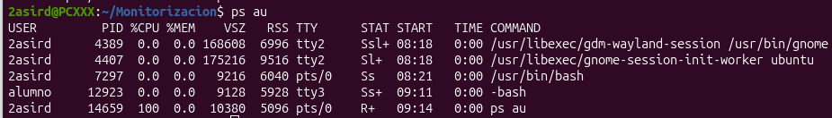
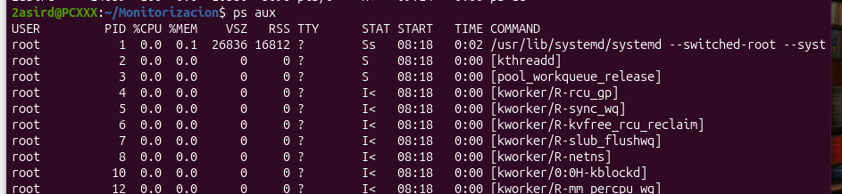
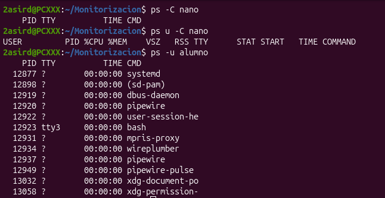
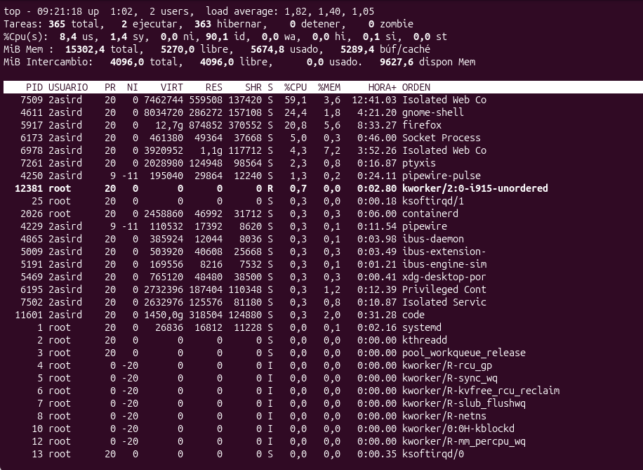
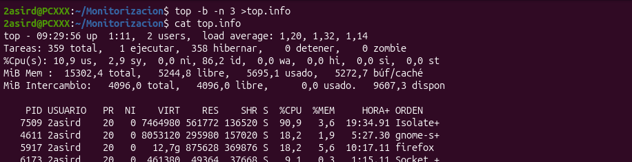
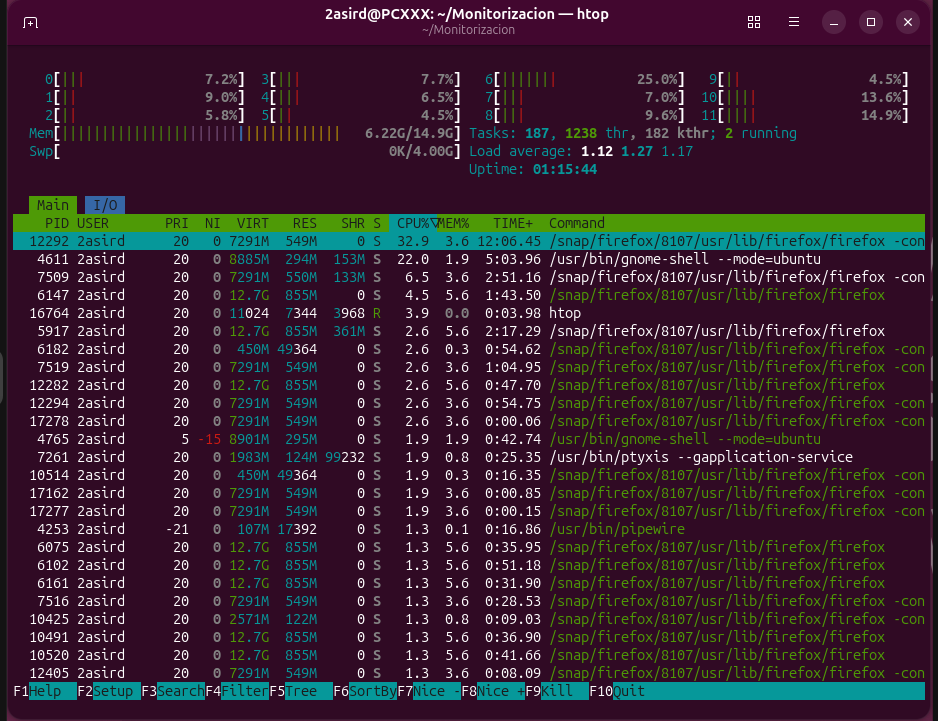
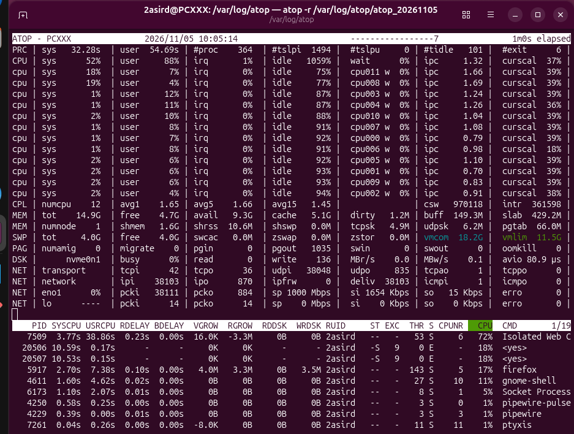
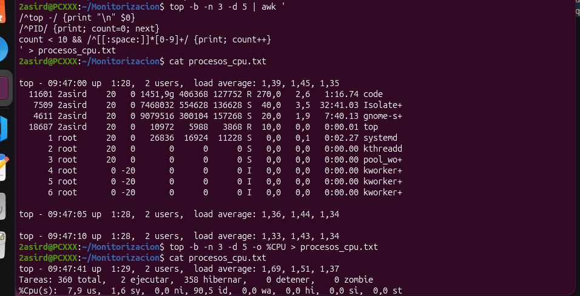

## Procesos 

ps: Muestra informacion de los procesos activos.

 ps a: Muestra los procesos asociados a terminales del sistema, excluyendo los líderes de sesión.
 

 ps au: Muestra los procesos de los usuarios asociados a terminales, incluyendo información sobre su estado y consumo de recursos.
 

 ps aux: Muestra todos los procesos activos de todos los usuarios, con información detallada como el PID, el uso de CPU y memoria, el estado y el comando ejecutado.
 

 ps -C: muestra los procesos que coinciden con el nombre indicado.
 ps u -C: muestra los procesos con el formato detallado de usuario que coinciden con el nombre indicado.
 ps -u: muestra los procesos pertenecientes al usuario indicado.
 

top: muestra en tiempo real los procesos activos y el consumo de CPU y memoria.
 Si pulsamos las siguientes letras:
  M --> ordena segun la memoria 
  p --> ordena segun la cpu
  t --> ordena segun el tiempo de uso
  N --> ordena segun el PID

 top -b -n 3 > top.info: guarda en el archivo top.info tres capturas del estado de los procesos.
 

htop: muestra los procesos activos en tiempo real con una interfaz interactiva y visual.

atop: muestra en tiempo real los procesos y el consumo de recursos del sistema.

Ejercicio: Utilizando el comando top necesitamos manda a nuestro jefe de proyecto un listado de los 10 procesos que consume mas cpu durante 3 periodos consecutivos

COMANDO:top -b -n 3 -d 5 | awk '...' > procesos_cpu.txt
Significado de cada parte:
- top: muestra los procesos activos y su consumo de recursos.
- -b: ejecuta el comando en modo texto, sin interfaz interactiva.
- -n 3: realiza 3 actualizaciones.
- -d 5: establece un intervalo de 5 segundos entre actualizaciones.
- awk: filtra los 10 procesos que más CPU consumen.
- >: guarda el resultado en un archivo.
- procesos_cpu.txt: archivo donde se almacenan los resultados.
- cat procesos_cpu.txt: permite visualizar el contenido del archivo.

