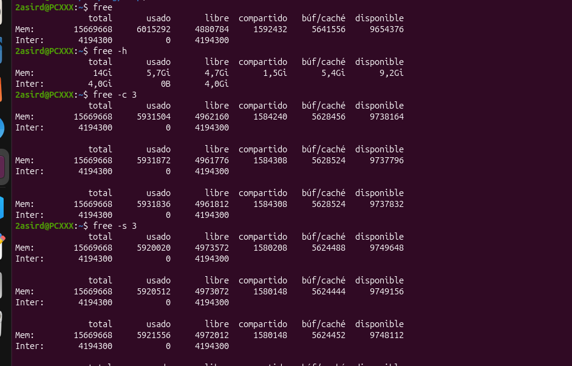
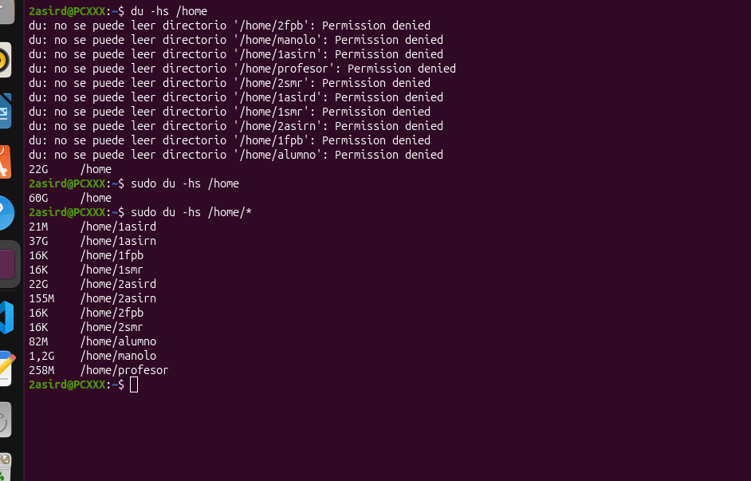
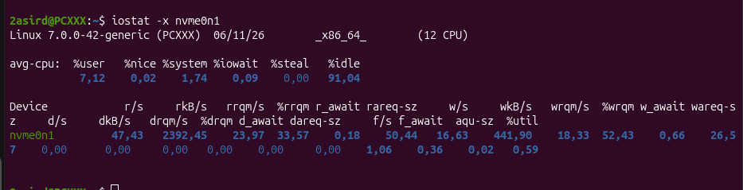
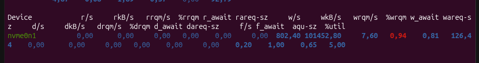

## Memoria, Espacio y Rendimiento del Disco

free: Muestra la cantidad de memoria libre y utilizada en el sistema 

 free -h: muestra el uso de la memoria RAM y SWAP en unidades legibles (MB, GB).
 free -c 3: muestra tres veces la información del uso de memoria.
 free -s 3: actualiza la información de memoria cada 3 segundos.
 

df: Muestra el espacio utilizado y disponible en los sistemas de archivos montados 

du: muestra el espacio de disco que ocupan los archivos y directorios.

 du -hs /home: muestra el espacio total que ocupa la carpeta /home en un formato legible.
 du -hs /home/*: muestra el espacio que ocupa cada carpeta dentro de /home, en un formato legible.
  

iostat: se utiliza para detectar problemas de rebdimiento en los dispositivos de almacenamiento 

 iostat -x: muestra estadísticas detalladas del rendimiento y uso de los dispositivos de almacenamiento.
 

 Hay que fijarse especialmente en:
 - r_await: tiempo medio de espera de las operaciones de lectura.
 - w_await: tiempo medio de espera de las operaciones de escritura.
 - d_await: tiempo medio de espera de las operaciones de descarte.
 - %util: porcentaje de tiempo que el dispositivo está ocupado. Un valor cercano al 100 % puede indicar saturación del disco.
 Importante: Estos valores sirven para detectar posibles cuellos de botella en el disco, no para medir directamente la temperatura de la CPU.
 

