## Trafico de la Red

tcpdump: Analizar el trafico

 sudo tcpdump -i eno1 -w capturas.pcap: captura el tráfico de red de la interfaz eno1 y lo guarda en el archivo capturas.pcap.
- sudo: ejecuta el comando con permisos de administrador.
- tcpdump: captura paquetes de red.
- -i eno1: selecciona la interfaz de red.
- -w capturas.pcap: guarda la captura en un archivo para analizarla posteriormente.
  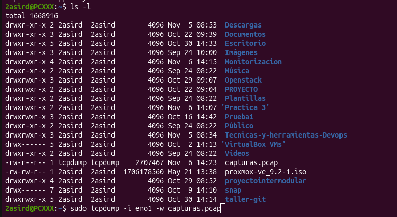

 tcpdump -r capturas.pcap: lee y muestra los paquetes de red almacenados en el archivo capturas.pcap.
 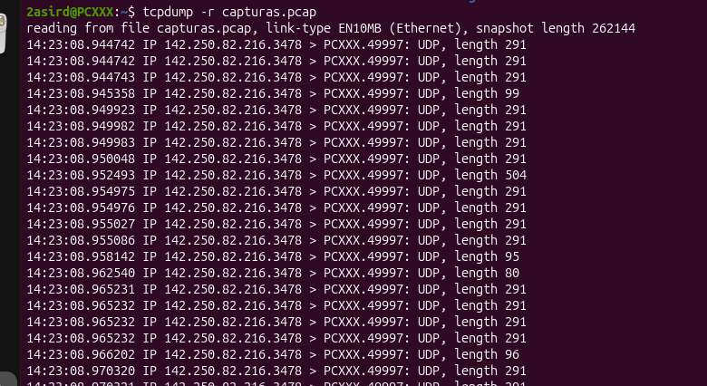

whois: muestra información sobre un dominio o una dirección IP, como el propietario, el registrador y las fechas de registro.
 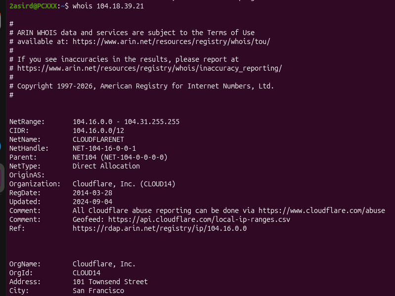

tcptrack: Conexiones activas 

 sudo tcptrack -i eno1: muestra en tiempo real las conexiones TCP activas de la interfaz de red eno1.
 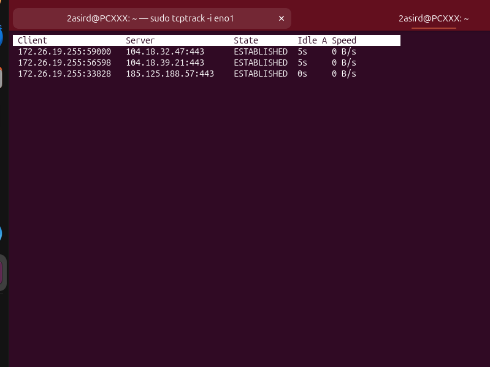
 
iptraf: Resumen visual
 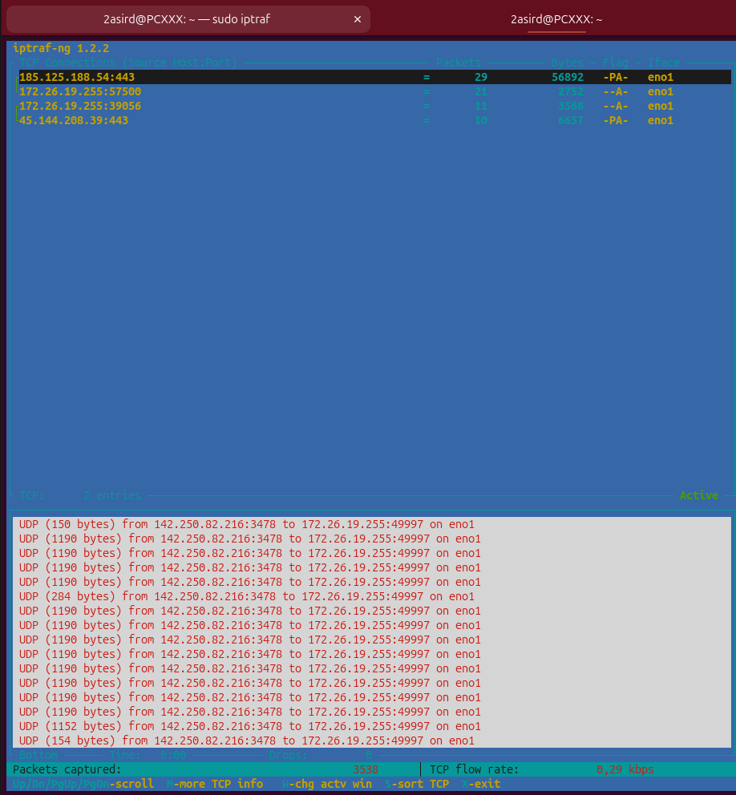

bmon: muestra en tiempo real el tráfico de red, indicando los datos enviados y recibidos por las interfaces de red.
 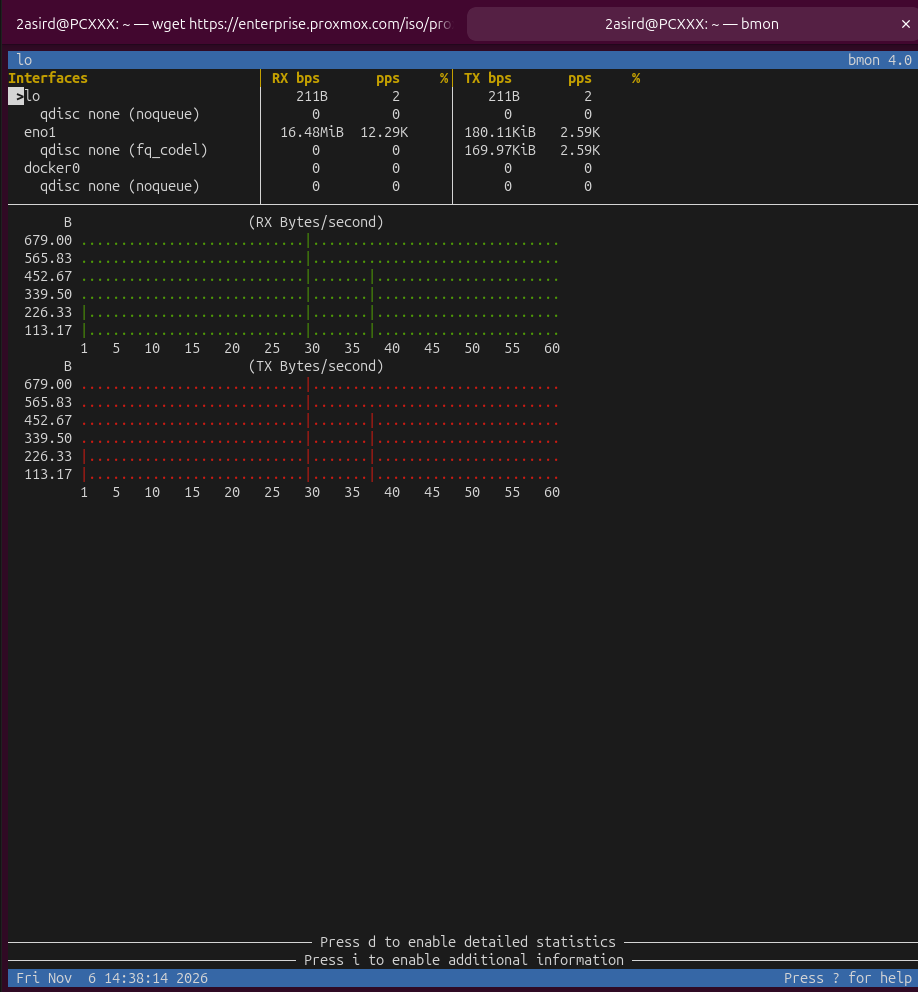

ss: ver puertps abiertos en el ordenador

 ss -plunt: muestra las conexiones de red, los puertos abiertos y los procesos asociados que están escuchando.
 -p: muestra los procesos asociados a las conexiones.
 -l: muestra los puertos que están escuchando.
 -u: muestra conexiones UDP.
 -n: muestra direcciones IP y puertos numéricos.
 -t: muestra conexiones TCP.
  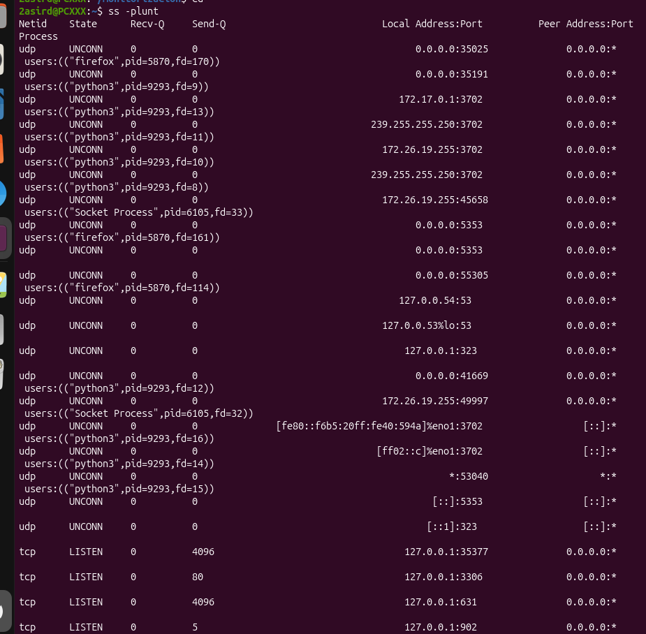

  ss -plnt: muestra los puertos TCP que están escuchando en el equipo, junto con los procesos asociados y sus identificadores (PID).
  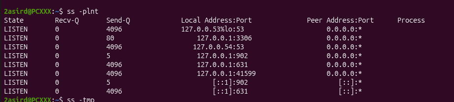

  ss -tmp: muestra las conexiones TCP y UDP, incluyendo información sobre los procesos y la memoria utilizada por los sockets.
  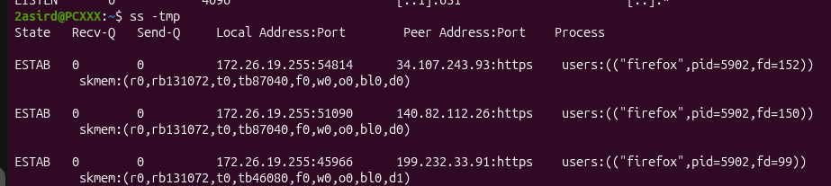
  
 nmap: Escanear y auditar redes.
 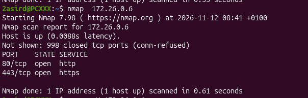
 
 nmap -sV: escanea los puertos abiertos de un equipo e identifica las versiones de los servicios que se están ejecutando en ellos.
 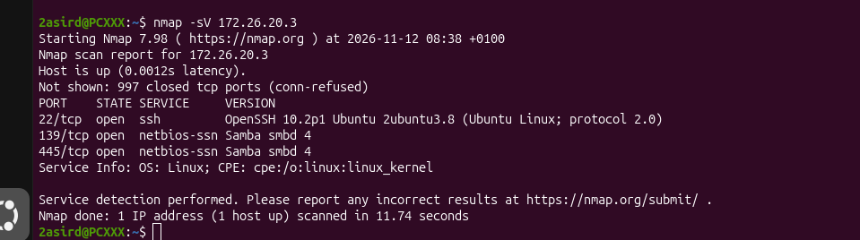

 nmap -sn: realiza un escaneo de descubrimiento de equipos activos en una red sin analizar los puertos.
 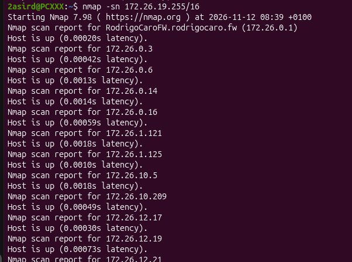
 
 arp: Escanear los mac de equipos a los que te has conectado.
 
 arp -n: muestra la tabla ARP con las direcciones IP y MAC asociadas, sin resolver los nombres de los equipos.
 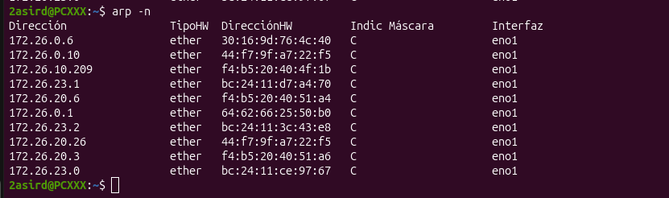
