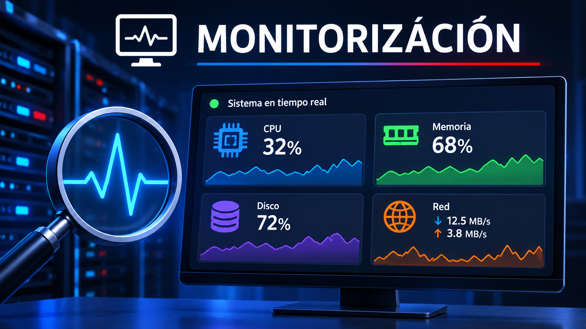

# 📊 MONITORIZACIÓN (PC_208)

La monitorización consiste en supervisar el funcionamiento de un sistema informático, controlando sus recursos y detectando posibles problemas de rendimiento.

## 📑 ÍNDICE

1. [Procesos](1.md)
2. [Memoria, espacio y rendimiento del disco](2.md)
3. [Tráfico de la red](3.md)
4. [Ejercicio](ejercico1.md)

## 🖥️ ¿QUÉ ES LA MONITORIZACIÓN?

La monitorización permite comprobar el estado de un equipo informático en tiempo real, analizar el uso de sus recursos y detectar posibles errores o problemas que puedan afectar a su funcionamiento.

## Webgrafía

- [ChatGPT – OpenAI](https://chatgpt.com/): apoyo en la búsqueda de información y explicación de comandos.
  
