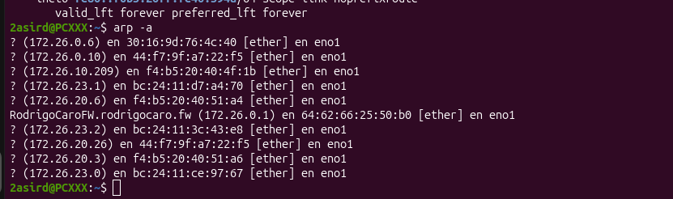
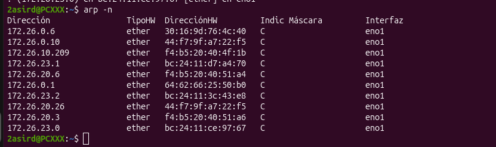
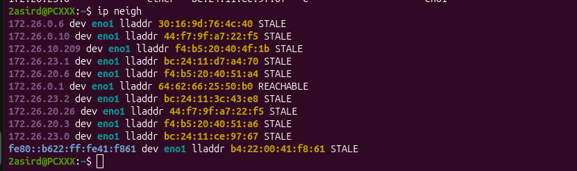
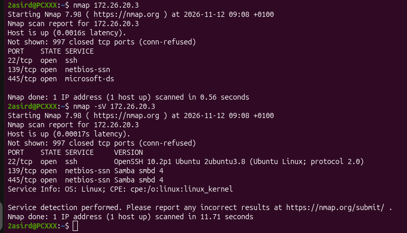

1.- Indica la IP y la interfaz de red de tu equipo.
172.126.19.255 y eno1
2.- Anota la puerta de enlace predeterminada.
172.26.0.1
3.- Indica la dirección de red y su prefijo o máscara
172.26.255.255/16

2.- Analizar y renovar una entrada ARP
1.- El profesor proporcionará la IP de su ordenador: __172.26.20.3________________.
Comprueba que está en tu misma red local IPv4.

2.- Ejecuta los siguientes comandos e indica qué hace cada uno.

arp -a: muestra las asociaciones entre direcciones IP y direcciones MAC.

arp -n: muestra la tabla ARP sin resolver los nombres de las direcciones.

ip neigh: muestra las asociaciones de vecinos IP y MAC de la red local.

3.- ¿Qué MAC aparece asociada a la puerta de enlace? ¿Por qué la tabla ARP
no muestra todos los equipos de la red?

La dirección MAC asociada a la puerta de enlace es la que aparece en la tabla ARP correspondiente a su dirección IP.

La tabla ARP no muestra todos los equipos de la red porque únicamente almacena las asociaciones IP-MAC que el equipo ha aprendido mediante la comunicación con otros dispositivos.

4.- Genera y consulta la entrada del profesor:
ping -c 2 IP_PROFESOR
ip neigh show IP_PROFESOR

5.- Elimina únicamente esa asociación en tu ordenador:
El segundo comando debes ejecutarlo inmediatamente después del primero.
ip neigh del IP_PROFESOR dev INTERFAZ
ip neigh show IP_PROFESOR

6.- Si no se genera automáticamente, puedes hacerlo:
ping -c 2 IP_PROFESOR
ip neigh show IP_PROFESOR

3.-Descubrir equipos con Nmap
1.- Utilizando el comando nmap, con la opción -sn, escanea:
Desde la 172.26.20.0 hasta 172.26.20.255
nmap -sn 172.26.0-255

2.- Qué hace exactamente la opción -sn
La opción -sn realiza un descubrimiento de equipos sin escanear sus puertos. Permite identificar qué dispositivos están activos en la red.

4.- Examinar puertos y servicios
1.- Escanea exclusivamente la máquina objetivo indicada por el profesor.
nmap IP_OBJETIVO
nmap -sV IP_OBJETIVO

¿Qué hace la opción -sV?
La opción -sV permite detectar las versiones de los servicios que se encuentran ejecutándose en los puertos abiertos del equipo objetivo.
